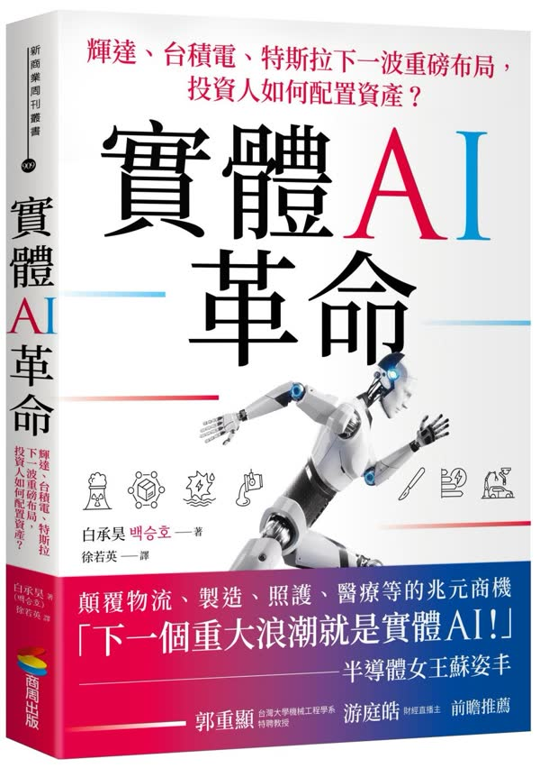

<YouTube id="kA5f2hc9FW0" />

## 摘要整理

### 美股重挫與半導體重災區

- 昨日美股科技股全面暴跌，費城半導體指數單日下跌接近 7%，納斯達克指數下跌 2.6%，為四個多月以來最大單日跌幅，費半防線已回落至 7 月份低點。
- 道瓊指數僅上漲 11 點、漲幅 0.02%，收在 52,867 點；標普 500 下跌 93 點、跌幅 1.21%，收在 7,663 點；納斯達克下跌 694 點、跌幅 2.6%，收在 26,008 點，三大指數相對仍撐在高位。
- 費半單日重挫 773 點、跌幅 6.7%，收在 10,731 點，個股方面 AMD 下跌 8%、應用材料下跌 8.16%、輝達下跌 4.4%、博通下跌 4.3%，台積電 ADR 下跌 4.5%、日月光 ADR 下跌 11%、聯電 ADR 下跌 6.5%。

### 多重利空交織與市場情緒

- 中東衝突升溫推升布蘭特原油突破每桶 112 美元，加上 Meta 與 SpaceX 財報後的融資疑慮，以及中國股市正式進入熊市，多重利空在短時間內接連釋出。
- 避險基金空頭部位已接近五年新高，整體水位升至過去五年第 99 個百分位，同時購買 CDS 部位持續上升，顯示避險情緒快速升溫。
- 市場最大問題並非單一利空夠壞，而是壞消息一個接一個出現，導致投資人恐慌感累積，符合快樂痛苦原則中「數個壞消息最好一次發佈」的心理現象。

### 原油上漲與通膨外溢壓力

- 布蘭特原油前日上漲 3.3%，價格約在每桶 112 美元，距離 3 至 4 月高點越來越近，冬季需求可能進一步擴大壓力。
- 美國家庭取暖用油自 2 月霍爾木茲海峽關閉以來上漲約 50%，柴油與取暖油價格每加侖達 6.14 美元，創歷史新高，緬因州與新罕布夏州約三分之一家庭依賴燃油取暖。
- 農產品現貨價格過去一年上漲 19%，其中黃豆與糖類分別上漲 32%、小麥上漲 31%、黃豆粉上漲 29%、棉花上漲 26%，僅可可與咖啡分別下跌 6% 與 22%，但終端價格並未同步下降。

### 川普政策成效與政治壓力

- 美國 9 月通膨升至 3.7%，明顯高於拜登卸任前的 2.9%；30 年期房貸利率從 7.04% 上升至 7.4%，遠高於川普承諾的 3%。
- 關稅稅率從 2.7% 上行至 11.6%，但 8 月貿易逆差仍高達 1,056 億美元；汽油價格每加侖 4.26 美元、柴油 6.32 美元，分別較上任時上漲 40% 與 70%，住宅電價從每度 16.27 美分升至 18.31 美分。
- 移民政策相對達標，非法越境人數從上任前一個月的 47,000 人降至 8,800 人，逮捕人數增加超過 4 倍，並宣稱已有 300 萬名無證移民離開美國，但整體 18 項主要承諾中約 70% 未完成。

### Meta 與 SpaceX 融資與信用風險

- Meta 第三季自由現金流轉為負 21 億美元，為 2012 年上市以來首次單季轉負，資本支出底標調升至 1,350 億美元、高標 1,450 億美元，表外採購與擔保承諾預估接近 7,400 億美元。
- Meta CDS 價格本周創下 2025 年關稅戰以來新高，股價財報後重挫約 7%；SpaceX 債券利差擴大，2031 年到期債券較同天期美債高出 1.2 個百分點，2036 年達 1.6 個百分點，接近非投資等級債水準。
- 甲骨文、SpaceX、Alphabet、Amazon、Meta、輝達與博通等七家企業 9 至 10 月 CDS 交易名目金額超過 90 億美元，遠高於 7 月的 20 億美元，顯示市場避險需求急遽上升。

### 軟銀與 AI 投資集中風險

- 軟銀因重押 OpenAI 達 650 億美元，股價從高點下跌約五成，市值蒸發至 24.7 兆日圓（約 1,570 億美元），單月跌幅達三成，成為日經指數當月表現最差成分股。
- 軟銀為支撐 AI 布局，於 9 月發動史上最大規模企業債發行，籌集 111 億美元，但借貸規模擴大反而加深市場對評價鬆動的疑慮。
- OpenAI 面臨中國低成本 AI 模型競爭，Anthropic 又提前上市搶資金，凸顯單一押注大型 AI 公司的高度集中風險。

### 中國股市進入熊市與監管壓力

- 滬深 300 自 6 月以來下跌約兩成，已連跌十周並正式進入熊市，即使第三季 GDP 優於預期仍無法挽回信心；香港恒生科技指數單日重跌接近 5%。
- MSCI 中國指數企業獲利成長仍有 11%，本益比基期快速下滑，但市場信心明顯弱於台股，國家隊操作的九檔 ETF 成交金額達 520 億人民幣，融資餘額卻降至 2025 年底以來低點。
- 市場監管總局召集阿里巴巴、京東、拼多多、小紅書、快手與字節跳動等電商平台，要求加強商品品質管理，引發對獲利能力受壓的擔憂，阿里巴巴股價出現兩個月來最大單日跌幅。

### AI 資源配置與生產力隱憂

- 中國上市公司數據顯示，AI Token 消耗量有 55% 集中在短劇與影片生成，僅 24% 用於電商與行銷、15% 投入軟體開發，真人風格影片 Token 消耗量約為純動畫的兩至三倍。
- DeepSeek 近期募資 150 億美元，寧德時代與騰訊等選擇入股，並開源 AI 推論技術以壓低晶片與能源成本，但使用量暴增後仍未明顯帶動真實生產力提升。
- 短期利空多半早已存在，真正長期風險在於 AI 資本與電力資源若持續錯配至娛樂內容，而非有效提升生產力，將削弱三至五年後的實質價值創造。

### 投資心法與人性觀察

- 三大指數多數仍在高位，費半因上半年漲幅較大而出現乖離回檔，從本益比週期與賣鏟企業獲利來看，股價已相對受委屈，長線仍具佈建參考價值。
- 投資人真實風險承受力需透過極端行情驗證，若未經歷過單日資產快速蒸發 10% 的情緒波動，容易高估自身承受能力，槓桿操作被迫平倉則會深刻烙印資產管理重要性。
- 人性在漲跌循環中不變，下跌時恐懼告訴自己再等更低而不敢出手，上漲時安全感回來又擔心錯過而追高，長期主義者需平衡耐心與行動力，才能撐到市場最終創下歷史新高。

## 觀點整理

### 美股與半導體重挫

1. 美股前一晚出現劇烈下挫，科技股尤其費半接近單日 7% 跌幅，納指也創下多月來最大單日跌幅，費半防線已回測 7 月低點。
2. **真正壓力集中在費半與相關 ADR**（輝達、AMD、應材、台積電、日月光、聯電等），三大指數相對仍處高位，屬於可接受的乖離調整，而非全面崩盤。
3. 台股因颱風休市，但若美股續弱，下週開盤壓力可能顯著放大。

### 多重利空交織與市場情緒

1. 本輪下跌並非單一事件，而是中東衝突推升油價、Meta 與 SpaceX 財報後的融資與表外承諾疑慮、中國股市正式進入熊市、歐洲政治與利差擴大等利空「一個接一個」釋放。
2. **市場最大問題不是個別利空本身有多嚴重，而是壞消息陸續出現卻無法一次出清**，符合「快樂痛苦四原則」：好消息要分開發、壞消息最好一次講完，否則投資人會因「慢慢磨」而更恐慌。
3. 避險基金空頭部位已接近五年新高，CDS 交易量從第三季起暴增，反映避險情緒升溫，但這更像情緒性回檔，而非立即出現破產潮的系統性危機。

### 原油、通膨外溢與政策侷限

1. 布蘭特原油突破每桶 112 美元，加上冬季需求與霍爾木茲海峽影響，取暖油、柴油已創歷史新高，部分家庭取暖成本大幅上升。
2. 農產品現貨價格普遍上揚（黃豆、小麥、糖等），肥料成本上漲進一步推升食品通膨，形成能源與糧食雙重外溢。
3. **川普多數核心承諾進度落後**：通膨、房貸利率、燃油與電價皆高於上任時水準，關稅雖大幅調升但貿易逆差仍高；製造業產出因自動化與海外設廠而增加，就業卻幾乎未見成長。
4. 移民政策是少數明顯達標項目，非法越境人數大幅下降。整體約 70% 承諾未完成或僅間接完成，若股市再明顯回檔，其政績亮點將更形稀薄。

### 財報、融資壓力與個股風險

1. Meta 第三季財報本身不差，但自由現金流轉負、資本支出上修、表外承諾規模龐大，加上 CDS 價格快速走高，市場開始質疑其估值與舉債能力。
2. SpaceX 債券利差已接近非投資等級水準，融資成本明顯偏高；軟銀因重押 OpenAI 而市值大幅蒸發，顯示單一標的與高槓桿布局的脆弱性。
3. **高殖利率與 CDS 暴增反映市場對 AI 資本支出能否轉化為生產力的疑慮**，但這些擔憂並非全新，更多是情緒在重複利空中打轉。分散持有權值股仍優於單壓個股。

### 中國股市與 AI 資源錯配

1. 滬深 300 已連跌多週並正式進入熊市，即使第三季 GDP 優於預期也無法提振信心；港股科技股單日重挫，國家隊進場護盤但融資餘額卻降至低點。
2. **中國 AI 的隱憂在於資源錯配**：Token 消耗高度集中於短劇與影片生成，真正用於電商、行銷或軟體開發的比例偏低，若大量算力與資本只創造娛樂內容而非生產力提升，長期風險更高。
3. 中國雖有廉價電力與算力優勢，但能否轉化為有效產值仍受質疑；美國則面臨融資成本過高、實體 AI 推進仍有距離的問題。

### 投資心態與長期視角

1. 極端波動是檢驗真實風險承受度的時刻。若從未經歷過單日大幅回檔或槓桿被迫平倉，對自身情緒與承受力的認知容易產生錯覺。
2. **對美股抱持「不信只漲不跌，但相信拉長時間終會創新高」的態度**；股市本質是等待的行業，誰能撐得久、等得起，勝率越高。
3. 費半從本益比與 AI 週期來看，上半年漲幅已大、下半年乖離回檔屬合理，但「賣鏟子」企業的長期價值仍在，現階段可能是佈建機會而非遊戲結束。
4. 人性不變：下跌時總覺得還會更低而不敢買，上漲時又怕錯過而追高。真正付出代價的往往不是看錯方向，而是不知道何時該閉嘴、何時該依循原本操作原則。

### 實體 AI 的長期機會

1. 短線融資循環、資源錯配與情緒波動都屬噪音；真正關鍵是 3–5 年內 AI 能否有效提升生產力。
2. 實體（物理）AI 若從電腦走向工廠、醫院、物流與家庭，將帶動大腦（運算與模型）、軀幹（感測、馬達、減速器）與整機廠的完整供應鏈，而非單一品牌勝出。
3. 目前機器人成本仍高，量產後零組件需求與單價變化才是觀察重點；一旦成本下降，衝擊與機會都將遠大於目前生成式應用。

## 閱讀推薦書籍：《實體 AI 革命》

<Cards>
  <Card title="實體AI革命" href="https://www.books.com.tw/products/0011064722">
    
  </Card>
</Cards>

### 書籍核心問題

- 若 AI 不再只停留在電腦裡回答問題、整理資料，而是走進工廠、醫院、物流中心，甚至進入家庭，整個產業鏈會發生什麼變化？

### 作者：白承浩

- 韓國科技技術院（KAIST）出身，主修機器人工程
- 研究過自動駕駛
- 具備跨國公司與能源設備相關工作經驗（17 年以上）
- 擅長從「技術如何第一波商業化」與「企業如何真正賺錢」的角度分析

### 核心主張：實體 AI（物理 AI）不會只有一家贏

- 實體 AI 將形成龐大供應鏈生態，而非單一贏家獨占
- 投資與觀察應跳脫只盯最終機器人品牌，轉而關注掌握技術、成本優勢與溢價能力的企業

### 產業三分法（本書最實用框架）

1. **大腦（運算與決策層）**  
   半導體、AI 模型、運算平台、相關軟體

2. **軀幹（感知與動作硬體）**  
   感測器、馬達、減速器、制動器等

3. **整機廠（系統整合）**  
   把大腦與軀幹整合成最終產品的廠商

### 關鍵洞察

- 未來機器人零組件的市場機會，重點不在「賣出幾台機器人」，而在：
  - 每台機器人需要多少零組件
  - 零組件單價是否會隨量產而下降
- 目前已能做出初步型機器人，但**成本仍太高**，如何有效壓低成本是實體 AI 能否真正突破的核心挑戰
- 目前仍處於前期高投入階段，短期融資循環與資源錯配（例如大量算力用在短劇、娛樂生成）是風險，但一旦成本降下，實體 AI 帶來的產業衝擊將非常巨大

### 與當前市場的對照

- 短期市場擔憂融資成本過高、資源錯配（AI 算力被大量用於娛樂短劇而非生產力提升）
- 本書提醒：真正值得關注的是實體 AI 能否在未來 3–5 年有效提升生產力，讓資源投入產生實質回報

### 結論

整體而言，這本書提供一個清楚的供應鏈視角，幫助投資人與產業觀察者從「只看終端品牌」轉向「看整條價值鏈的成本與技術卡位」。
