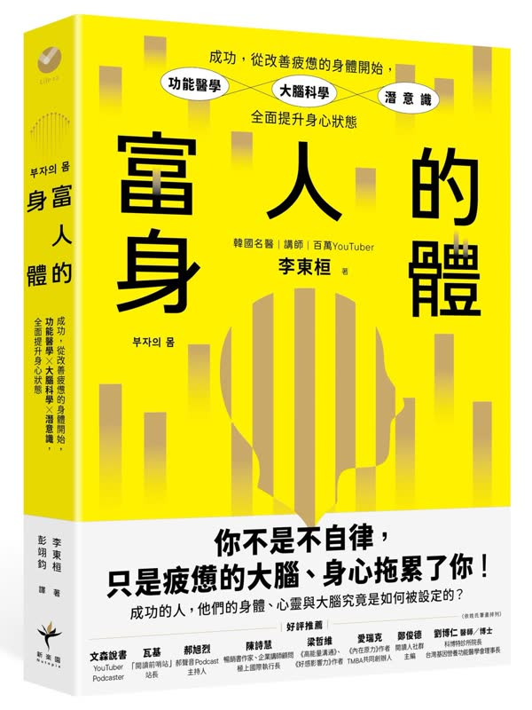

<YouTube id="jm9T-NgW0pY" />

## 摘要整理

### 美股重挫與費半崩跌

- 道瓊指數單日暴跌 1,833.3 點、跌幅約 4%，收在 51,523 點；標普 500 下跌 334 點、跌幅 4.36%，收在 7,353 點；那斯達克下跌 1,421 點、跌幅 5.52%，收在 24,315 點，科技股跌幅明顯加重。
- 費城半導體指數（費半）單日重挫 1,257 點、跌幅 12.25%，收在 9,011 點，正式跌破萬點大關並出現跳空缺口，跌幅已接近月線等級，遠超其他三大指數的均值回檔。
- 個股方面，AMD 暴跌 17.26%、博通跌 10.4%、輝達跌 9.2%、英特爾跌 13%、高通跌 9.49%；記憶體族群更慘，美光跌 17%、Sandisk 跌 22%、希捷跌 16%、SK 海力士 ADR 跌 13.4%，台積電 ADR 也跌 10.78%、日月光 ADR 跌 20%、聯電 ADR 跌 16%。

### AI 監管政治衝擊與資料中心疑慮

- 民主黨奪下國會參眾議院後，市場擔憂 AI 資料中心建設速度將放緩，亞利桑那州眾議員安薩里公開主張暫停先進 AI 研發、全面禁止人工超級智慧，並計畫成立聯邦人工智慧部，違規者恐面臨最高 20 年監禁。
- 德州占全美資料中心容量約 26.7%，是 AI 建設最大且增長最快的核心重鎮，民主黨勝選後衝擊首當其衝；喬治亞州民主黨主張全州暫停新建資料中心至少 1 年，俄亥俄州兩黨皆傾向限制或放緩發展。
- 民意方面，支持住家附近新建資料中心的比例從去年 10 月的 42% 降至今年 10 月僅剩 15%，反對比例高達 75%，已有約 20 州陸續考慮暫停建設，但市場建置需求仍強，海外市場也可能承接部分產能。

### 恐慌情緒與歷史回檔經驗

- 恐慌指數 VIX 單日暴漲約 70%，來到 28 左右，但歷史上前 20 大 VIX 單日漲幅事件發生後，標普 500 未來 1 個月平均仍上漲 2%、3 個月平均上漲 5%，顯示急漲恐慌不一定代表持續下跌。
- 川普在 Truth Social 發文指出今日股市崩盤因民主黨週二大勝，並強調共和黨造就股市繁榮、民主黨是破壞象徵，同時呼籲支持者勿恐慌，美國很快會更強大。
- 本輪費半從高點已回檔約 35% 至接近 4 成，納斯達克也跌破 200 日移動平均線，但整體仍屬單一板塊熊市，微軟與蘋果前兩日還創歷史新高，顯示大型科技股跌幅相對有限。

### 半導體估值大幅下修

- 費半本益比昨日約 16.18 倍，經此重挫後可能降至約 14 倍，已接近 2022 年或本世紀以來相對低點；半導體類股預估本益比約 13.8 倍，較標普 500 便宜約 25%，相對折價幅度為 12 月以來最大，甚至是本世紀以來最低。
- 輝達 GB200 相關算力價格今年上漲約 50%、H100 年增約 26%，甲骨文 AI 服務續約與轉售平均溢價約 20%，顯示相關價格仍在上漲，但股價全面鬆動導致本益比持續走低。
- 即使獲利持續成長，股價回檔已讓估值大幅壓縮，市場開始討論本輪是否為景氣循環過渡期，或 AI 生產力爆發期中罕見的相對低點。

### 韓股與台股連動衝擊

- 韓國股市出現熔斷，SK 海力士從高點已跌 53%、三星跌 40%，KOSPI 前瞻本益比驟降至僅約 2 倍（過去一年曾達十餘倍），避險基金對亞洲股市的調節以韓國為重，賣壓比台股更強。
- 台股過去 6 個交易日累計下跌 5,461 點，夜盤台指期也接近下跌 3,000 點；外資昨日賣超約 1,024 億元，三大法人合計賣超約 1,234.56 億元，今日外資仍是重要賣壓來源。
- 台股與費半高度連動，若今日開盤跌幅達 10% 可能接近 3 萬 8 千餘點，市場關注是否開盤即收盤，以及官股是否進場護盤、守住 4 萬點整數關卡或年線。

### 籌碼與槓桿清洗現象

- 大盤融資維持率降至約 163，扣除 ETF 後的整戶維持率昨日已觸及 134 邊緣，短短兩週降幅約 11%，部分投資人已先行離場，但融券餘額反而有鬆動增加跡象。
- 元大台灣 50 正 2（00631L）融資張數從 276,349 張增至約 34.8 萬張，短短 6 個交易日增加 72,379 張、增幅 26%，顯示部分散戶仍持續加碼槓桿，與現貨賣壓形成對比。
- 費半三倍槓桿 ETF（SOXL）從約 300 美元附近跌至 45 美元，跌幅達 80%，幾乎回到 2025 年底水準；若要回到高點需上漲約 500%，凸顯槓桿 ETF 波動耗損與陷阱。

### 長期投資觀點與歷史尺度

- 即使經歷重挫，今年四大指數與台股目前仍維持正報酬；回顧 2020 年疫情年標普 500 全年仍漲 18.4%、2025 年關稅戰後全年仍漲 17.9%，顯示放大時間尺度後多數重大利空最終只是長期上升曲線中的波動。
- 過去期中選舉年，市場從高峰到低谷平均跌幅約 17.5%，但後續一年平均反彈幅度達 31% 起跳，政策不確定性往往在未來一年否極泰來。
- 建議以科技型 ETF 參與行情並適度回測形成投資中心邏輯，避免個股長期存活風險與頻繁換股失誤；槓桿應用於超車而非飆車，重點在確保現金規劃足以抵擋恐慌、不被強制洗出場。

## 觀點整理

### 美股重挫與板塊分化

1. **費半成為重災區**，單日暴跌幅度遠超大盤，已跌破萬點並接近月線等級修正，帶有流動性與系統性風險味道，而道瓊、標普與那斯達克僅屬正常均值回檔。
2. 科技股與記憶體股全面重挫，但整體美股四大指數今年仍維持正報酬，顯示此次下跌集中在 AI 相關板塊，並非全面熊市。
3. 市場估值大幅壓縮，費半本益比快速滑落至近年甚至本世紀相對低點，獲利持續成長卻未反映在股價上。

### AI 監管與民主黨勝選衝擊

1. **核心利空來自民主黨中期選舉大勝後的 AI 監管預期**，市場擔心資料中心建設放緩與研發受阻，衝擊程度被視為可能超過先前關稅戰。
2. 部分民主黨議員提出成立聯邦 AI 部、暫停先進 AI 研發、禁止超級智慧等主張，加上民意對資料中心反彈強烈（支持新建比例大幅下滑），形成政治與社會雙重壓力。
3. 德州作為最大資料中心聚落首當其衝，喬治亞、俄亥俄等州也出現暫停或嚴格評估新建的聲浪，但主持人認為多屬政治表態，全面長期停建的機率不高。

### 市場情緒與外部反應

1. **恐慌指數單日暴漲**反映情緒極度緊張，但歷史上類似 VIX 急升後，後續一至三個月標普往往仍有正報酬，恐慌本身不必然延續下跌。
2. 川普將崩盤歸咎於民主黨勝選，並強調共和黨創造股市繁榮，但主持人提醒其去年關稅戰也曾造成類似衝擊，外部政治事件的影響需保持一致邏輯看待。
3. 殖利率下滑與通膨降溫跡象浮現，聯準會升息壓力減輕，市場卻仍積極尋找利空作為賣出藉口。

### 長期投資邏輯與歷史借鏡

1. **資料中心放緩未必全然負面**，適度監管與建設節奏調整可能延長 AI 榮景、緩解通膨副作用，並避免未來更激烈的政策反彈。
2. 美國股市長期仍以上漲為主，2020 疫情與 2025 關稅戰等重大利空年最終皆錄得可觀正報酬，短期劇烈波動多只是長期上升曲線中的小波段。
3. 半導體與科技股估值已顯著低於大盤，本輪修正更像景氣循環過渡或生產力爆發期中的難得低點，而非 AI 趨勢終結。

### 台股、韓股與全球連動

1. **台股受費半高度連動**，連續重挫後外資賣壓均衡但持續，內資與官股有護盤動機，尤其考量地方選舉前的財富效應與消費信心。
2. 韓國股市更為極端，記憶體大廠從高點大幅回落，大盤前瞻本益比壓縮至極低水準，顯示去槓桿與國際賣壓雙重打擊。
3. 全球資金配置調整與避險基金調節加劇亞洲科技股壓力，但台股融資降幅與籌碼清洗尚未完全結束，需觀察美股止跌訊號。

### 籌碼、槓桿與風險管理

1. **槓桿與融資部位成為洗盤重點**，正二與三倍槓桿 ETF 出現反向增倉或大幅回檔，顯示部分投資人仍樂觀加碼，但波動耗損與回本難度極高。
2. 融資維持率逼近警戒，融券略增，籌碼尚未完全乾淨，主動型 ETF 跌幅甚至重於部分槓桿商品，顯示情緒與資金面仍脆弱。
3. 主持人強調槓桿應用於超車而非飆車，現貨長期佈局無妨，但融資與高倍槓桿在急跌中易被洗出場。

### 操作建議與心態調整

1. **偏好以科技型 ETF 參與**，避開個股長期存續與估值判斷困難，透過分散降低單一股票風險，並在回檔時適度加碼追求超額報酬。
2. 急跌後乖離已大，不適合此時恐慌離場；若需停損宜等反彈，重點在於確保現金與部位能熬過進一步波動，而非糾結資料中心延遲多久。
3. 中期選舉年歷史上波動較大，但後續一年平均反彈可觀；真正該反思的是自身部位與現金規劃，而非無效的政治假設。
4. 身體健康優先於帳面損益，短期劇烈波動下維持生活品質與心態穩定，才是長期投資能持續的關鍵。

## 閱讀推薦書籍：《富人的身體》

<Cards>
  <Card title="富人的身體" href="https://www.books.com.tw/products/0011057672">
    
  </Card>
</Cards>

### 作者：李東桓

- 韓國家庭醫學科醫師
- 功能醫學第一代專科醫師
- 百萬訂閱 YouTuber

### 核心觀點

- 你不是不自律，只是疲憊的大腦、身心拖累了你。
- 成功的人，他們的身體、心靈與大腦，被設定成「高能量、高行動力」的狀態。
- 身心一體：想要成功、實現自我，必須先從改善疲憊的身體開始。人生可以逆轉，且有科學實證、具體可行的方法。
- 先讓身體健康、讓內心幸福，人才會真正產生動力去追求目標（而非等成功後再照顧身體）。

### 作者親身經歷

- 約 18–19 年前：長期過勞（每天看診到晚上 9 點）、靠暴飲暴食與啤酒紓壓、體重超過 100 公斤、經常頭痛、負能量滿滿、身心失衡。
- 透過功能醫學、身心醫學、腦科學、正向心理學等學習與生活方式調整，徹底改變身心狀態，成為名醫、工商管理博士、名講師、百萬 YouTuber。

### 成功人士的「成功設定值」

1. 克服無力感的力量
2. 撐起人生的柔軟度
3. 飽滿的幹勁與挑戰精神
4. 後設認知（最了解「我」的「我」）
5. 穩固的同理與體貼

### MBS 最佳化計畫（6 階段）

MBS = Mind & Mental（內心與心理）＋ Body & Brain（身體與大腦）＋ Subconscious mind（潛意識）

1. **身體與內心的對齊**  
   健康的身體孕育健康的心，健康的心打造充滿能量的身體。建立能帶動內心變化的身體習慣。

2. **壓力視角訓練**  
   調整看待壓力的方式，降低身心負擔。

3. **建立健康的人際關係**  
   透過良好互動補充能量、減少消耗。

4. **引導現實的方法**  
   把理想轉化為可執行的現實行動。

5. **潛意識最佳化**  
   重設潛意識，讓它成為助力而非阻力。

6. **目標設定與成功例行習慣**  
   建立可持續的目標與日常習慣，讓高能量狀態成為常態。

### 其他重點

- 功能醫學核心：把細胞功能調整到最佳狀態，恢復能量產生能力（ATP 等）。
- 身體治療與心理治療同樣重要，缺一不可。
- 書中結合臨床案例、作者自身轉變故事，以及具體可實踐的方法，適合在高壓時期（如股市大跌時）照顧身心。
- 強調「活著就是勝利」：健康長壽本身就是最大的優勢。
